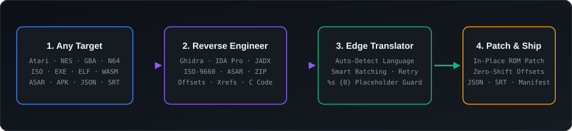

<div align="center">

[English](../../README.md) · [کوردیی سۆرانی](README_ku.md) · [Türkçe](README_tr.md) · [日本語](README_ja.md) · [한국어](README_ko.md) · [简体中文](README_zh.md) · [Español](README_es.md) · **Français** · [Deutsch](README_de.md) · [Русский](README_ru.md) · [العربية](README_ar.md)

# TA : Traduisez n’importe quoi

### Un MCP pour rétro-ingénier et traduire tout logiciel, application, binaire ou ROM de jeu dans n’importe quel langage.

**Voir n’importe quelle application, programme de bureau, APK mobile, ROM de jeu ou ISO que vous souhaitez dans votre langue. Rétro-ingénierie, traduisez-le dans n’importe quelle langue du monde, et patchez-le en quelques secondes.**

[](https://github.com/zany4r/ta/stargazers)
[](../../LICENSE)
[](https://nodejs.org/)
[](../../mcp.json)
[](#quick-start)
[](#supported-engines)
[](https://t.me/translate_anything)

<a href="https://t.me/translate_anything"></a>

[Démarrage rapide](#quick-début) · [Présentations](#showcases) · [Comment fonctionne TA](#how-ta-works) · [Ce que vous pouvez traduire](#what-vous-pouvez-traduire) · [Moteurs pris en charge](#supported-moteurs) · [FAQ](#faq) · [Telegramme](https://t.me/translate_anything)

<code>npx translate-anything setup</code>

</div>

> [! IMPORTANT]
> Translate Anything ('ta') s’exécute localement sur votre machine et utilise le terminade Edge Translator
> ('edge.microsoft.com/translate/translatetext') sans aucune clé API requise.
> Pour une décompilation profonde, TA se connecte automatiquement à votre installation locale **Ghidra**, **IDA Pro**, **JADX** ou **wasm2wat** — tandis que l’extraction intégrée et le patching ROM/binaire sur place fonctionnent dès la sortie de la boîte sans aucune dépendance externe.

<div align="center">

<br />

 Reverse Engineer -> Edge Translator -> Patch and Ship" width="960" />

<br /><br />

</div>

---

Vous voulez localiser un « .exe » Windows, une application de bureau Electron, un outil ELF Linux, un .apk Android, un fichier de sous-titres ou un jeu classique Atari/PlayStation dans **n’importe quelle langue** — sans avoir son code source ? Demandez à votre agent de l’inspecter et de traduire avec **TA**.

TA connecte votre agent IA (via **MCP**) et votre terminal (via **CLI**) à des extracteurs universels de rétro-ingénierie : **Ghidra Headless**, **IDA Pro**, **JADX** et l'**API Edge Translator* — puis réinstalle en toute sécurité les chaînes traduites sans modifier les adresses ni corrompre les en-têtes sans déplacer.

## Démarrage rapide

### Mettez en relation votre agent (MCP)

Avec Node.js 20+ installé, clonez et construisez TA, puis exécutez « setup » pour installer la compétence de l’agent et imprimer votre enregistrement MCP :

```bash
git clone https://github.com/zany4r/ta.git
cd ta
npm install
npm run build
node dist/cli/index.js setup
```

Ajoutez le serveur MCP « traduire n’importe quoi » à **Antigravity**, **Claude Desktop**, **Cursor** ou **Codex** :

```json
{
  "mcpServers": {
    "translate-anything": {
      "command": "node",
      "args": ["/absolute/path/to/translate-anything/dist/mcp/server.js"]
    }
  }
}
```

Essayez de demander à votre agent :

```text
Reverse engineer this Windows app with Ghidra, translate all UI strings into Japanese (ja), and patch a localized copy.
```

### Utiliser la TA depuis le terminal (CLI)

```bash
# Check which RE engines (Ghidra, IDA Pro, JADX, ILSpy, Rizin) are ready
ta engines

# Auto-route any app, binary, ISO, APK, or ROM to the right decompiler
ta decompile ./MyDesktopApp.exe
ta decompile ./MyAndroidApp.apk
ta decompile ./game.iso

# Translate a Windows .exe / Linux ELF / macOS binary into any language (es, ja, ar, fr, de, ku, zh-Hans...)
ta ghidra ./app.exe --decompile --to es --out ./app_es.exe --patch
ta translate ./linux-tool --to fr --out ./linux-tool-fr --patch

# Translate an Electron .asar app, APK, or ISO and patch it directly back inside the package
ta translate ./app.asar --to ja --out ./app_ja.asar --patch
ta translate ./app.apk --to fr --out ./app_fr.apk --patch
ta translate ./game.iso --to es --out ./game_es.iso --patch
ta translate ./en.json --to ar --out ./ar.json
ta translate ./movie.srt --to de --out ./movie_de.srt

# Inject a custom .ttf/.otf font into an Electron .asar / APK, or 1bpp/2bpp bitmap glyphs into a ROM
ta font ./app.asar --font ./NotoSans.ttf --out ./app_customfont.asar --family NotoSans
ta font ./game.nes --font ./glyphs.json --out ./game_font.nes --offset 0x1000 --bpp 2
ta translate ./game.a26 --to ku --out ./game_ku.a26 --patch
```

---

## Vitrines

<table>
<tbody>
<tr>
<td>
<h3>Desktop Software (<code>.exe</code> / <code>.dll</code> / <code>ELF</code> / <code>Mach-O</code>)</h3>
<p>Decompile les applications natives avec Ghidra ou IDA Pro, récupérer les chaînes d’interface utilisateur UTF-16LE/ASCII avec des références croisées de fonctions, traduire dans n’importe quelle langue (japonais, espagnol, arabe, allemand, etc.) et patcher en place.</p>
<code>ta ghidra ./app.exe --decompile --to ja --out ./app_ja.exe --patch</code>
</td>
</tr>
<tr>
<td>
<h3>Electron <code>.asar</code> &amp; Android <code>.apk</code> Apps</h3>
<p>Unpack Electron ASAR Pickle archive ou décompile les APK Android avec JADX, extrait les chaînes d’interface utilisateur et les ressources <code>strings.xml</code>/<code>.json</code>, et conserve les espaces réservés de format (<code>%s</code>, <code>{0}</code>, <code>\n</code>).</p>
<code>ta translate ./app.asar --to es --out ./es_manifest.json</code>
</td>
</tr>
<tr>
<td>
<h3>PlayStation / PSP <code>.iso</code> &amp; ROMs</h3> Console
<p>Parse Descripteurs de volume primaire ISO-9660, localisez <code>SYSTEM. CNF</code> exécutables de démarrage, sélectionnez automatiquement <code>6502</code> / <code>ARM</code> / <code>68000</code> / <code>MIPS</code> dans Ghidra, et patchez les chaînes ROM à l’offsets.</p> exacte en octets
<code>ta decompile ./game.iso</code>
</td>
</tr>
</tbody>
</table>

---

## Comment fonctionne TA

TA expose **11 outils MCP** (et les commandes CLI correspondantes) afin que votre agent puisse inspecter, décompiler, traduire, injecter des polices personnalisées et patcher n’importe quelle cible :

| Outil MCP | Objectif |
| :--- | :--- |
| 're_engines_status' | Discover les moteurs RE installés (Ghidra, IDA Pro, JADX, ILSpy, pycdc, wasm2wat, Rizin, Java, intégré). |
| 'inspect_target' | Détection rapide d’octets magics et extraction de chaînes avec décalages d’octets exacts, budgets 'maxBytes' et scores de confiance. |
| 'inspect_iso' | Analyser les images du disque ISO-9660, lister les fichiers/secteurs internes, détecter 'SYSTEM. Les exécutables de démarrage CNF, ou extraire les fichiers. |
| 'decompile_target' | Auto-routeur universel : choisit ISO-9660 + Ghidra, ROM + CPU Ghidra, JADX pour APK, ou « wasm2wat » pour WASM. |
| 'ghidra_analyze' | Exécutez Ghidra Headless pour extraire des chaînes définies, des décalages de fichiers, des adresses virtuelles, des xrefs et du pseudocode C. |
| 'ghidra_translate' | Pipeline Ghidra + Edge Translator de bout en bout avec patching binaire/ROM optionnel en place. |
| 'translate_text' | Traduisez des tableaux de chaînes via l’API Edge Translator avec protection par lots et réserve. |
| 'translate_target' | Inspecter → traduire → reconstruire JSON/SRT ou binaire/ROM intégré de bout en bout. |
| 'patch_binary' | Patchez en toute sécurité les chaînes traduites dans n’importe quel binaire/ROM avec des décalages d’octets exacts sans déplacer les adresses. |
| 'list_languages' | La liste supportait les codes linguistiques du traducteur Edge ('ku', 'kmr', 'ar', 'es', 'ja', 'zh-Hans', etc.). |

---

## Ce que tu peux traduire

| Catégorie | Formats pris en charge |
| :--- | :--- |
| **ROMs rétro & console** | Atari 2600 ('.a26'), Atari 7800 ('.a78'), Atari Lynx ('.lnx'), NES ('.nes'), SNES ('.sfc'/'.smc'), Game Boy / GBC ('.gb'/'.gbc'), GBA ('.gba'), Sega Genesis / Mega Drive ('.md'/'.gen'), Nintendo 64 ('.z64'/'.n64'/'.v64'), Nintendo DS ('.nds') |
| **Images de disque** | ISO-9660 ('.iso' — PS1, PS2, PSP, disques optiques PC) |
| **Exécutables natifs** | Windows PE ('.exe', '.dll', '.sys'), Linux/Console ELF ('.elf', '.so'), macOS Mach-O, WebAssembly ('.wasm'), Unity 'global-metadata.dat' |
| **Packages d’applications** | Electron ('.asar'), Android ('.apk', '.aab'), iOS ('.ipa'), Java ('.jar'), extensions de navigateur ('.crx', '.xpi'), '.zip' |
| **Localisation & Média** | '.json', '.arb', '.xml', '.resx', '.po'/'.pot', '.srt', '.vtt', '.ass', '.strings', '.ini', '.properties', '.txt', '.md' |

---

## Moteurs pris en charge

- **Moteur universel intégré** *(Toujours prêt)* — Détecteur de format zéro dépendance, analyseur ISO-9660/ASAR/ZIP, scanner UTF-16LE/ASCII et patcher sur place.
- **Ghidra Headless** *(Gratuit & Open Source)* — Détecté automatiquement à partir de 'GHIDRA_INSTALL_DIR' ou des chemins d’installation standards ; exécute [TranslateAnythingGhidra.java](bridge/ghidra/TranslateAnythingGhidra.java) avec sélection automatique du processeur de la console.
- **IDA Pro / Hex-Rays** *(Optionnel)* — Prêt via [ta_ida_bridge.py](pont/ida/ta_ida_bridge.py) pour 'idat64' headless ou IDA MCP.
- **JADX / ILSpy / pycdc / wasm2wat / Rizin** *(Optionnel)* — Détecté automatiquement lors de l’installation sur 'PATH'.

---

## FAQ

<details>
<summary><strong>Which agents peuvent utiliser TA ?</strong></summary>

Tout agent supportant les serveurs MCP stdio locaux, y compris Antigravity, Claude Desktop, Claude Code, Cursor et Codex. Exécutez 'ta setup' pour installer la compétence fournie et imprimez la configuration MCP exacte.

</details>

<details>
<summary><strong>Do que j’aie besoin d’installer Ghidra ou IDA Pro ? </strong></summary>

Non pour l’extraction basique et la traduction ROM/JSON/SRT/ASAR — le moteur intégré fonctionne sans aucune dépendance externe. Installez **Ghidra** (gratuit) lorsque vous souhaitez des références croisées de fonction ('xrefFunctions') et la décompilation de pseudocode C.

</details>

<details>
<summary><strong>Do besoin d’une clé API pour la traduction ? </strong></summary>

Non. TA utilise le terminade Edge Translator (« edge.microsoft.com/translate/translatetext ») avec traitement automatique par lots, réessai/refoulement et protection provisoire (« %s », « %d », « {0} », « \n ».

</details>

<details>
<summary><strong>How le patching binaire/ROM sur place évite-t-il de corrompre les fichiers ? </strong></summary>

Les exécutables et les ROMs de jeu reposent sur des décalages mémoire fixes et des tables de saut. « patch_binary » n’insère jamais ni ne déplace des octets ; il remplit « [offset, offset + maxBytes) » et écrit la chaîne traduite à l’intérieur de la fenêtre originale (tronquant nettement aux limites des caractères si nécessaire, ou en sautant ou en faisant des erreurs en mode « skip-overflow »/« strict »).

</details>

---

## Documentation

- [Licence MIT](LICENCE)
- [Guide de contribution](../../CONTRIBUTING.md)
- [Politique de sécurité](../../SECURITY.md)
- [Avertissement](../../DISCLAIMER.md)
- [Agent Skill Definition](../../skills/translate-anything/SKILL.md)
